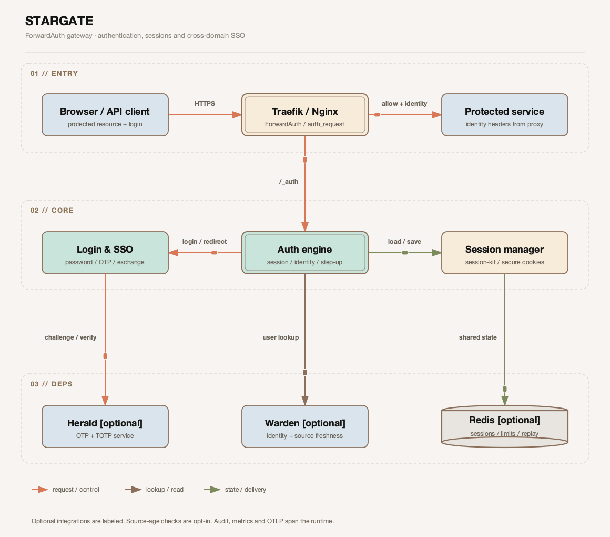
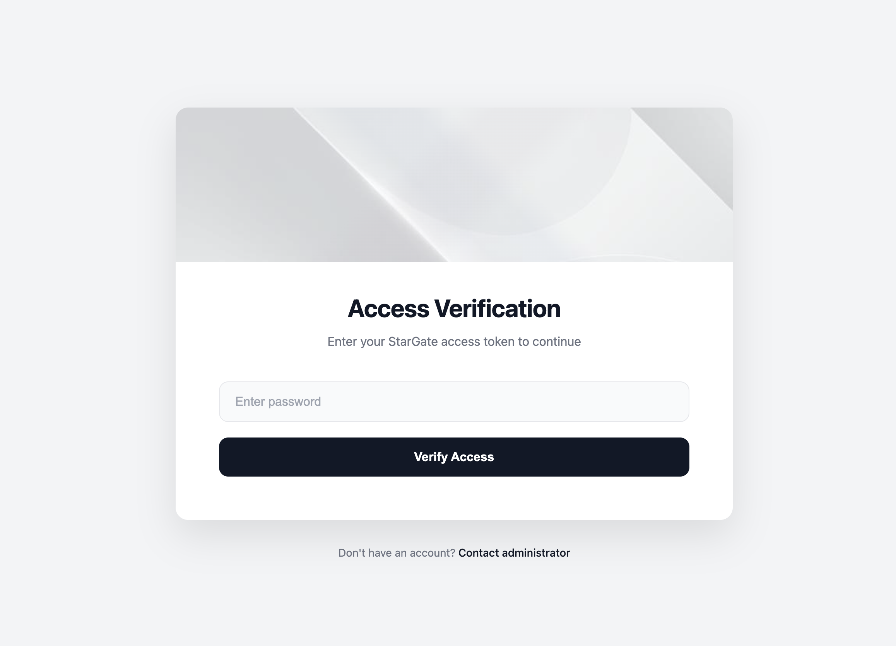

# Stargate - Forward Auth Service

[](./.github/go-test-report.md) [](./.github/goreportcard-report.md) [](LICENSE) [](https://golang.org)


> **🚀 Your Gateway to Secure Microservices**


Stargate is a lightweight Forward Auth service that centralizes authentication at the reverse-proxy boundary. It integrates with Traefik and exposes password, session, Warden, and Herald-backed authentication flows for protected services.

v1.3.3 sends only HMAC credentials when a Herald HMAC secret is configured. Read the [credential selection and rollback guide](docs/enUS/DEPLOYMENT.md#herald-credential-selection-v133) before upgrading dual-configured clients.

v1.3.2 preserves retryable OTP verification failures as 503/409 without automatically retrying a code. See the [upgrade and rollback guidance](docs/enUS/DEPLOYMENT.md#otp-verification-error-handling-v132); existing session deadlines and record formats are unchanged.

v1.3.1 requires shared gateway-issued OTP bindings and Herald bound verification. Read the [upgrade and rollback instructions](docs/enUS/DEPLOYMENT.md#bound-login-challenge-upgrade-and-rollback). Existing v1.3.0 revocable sessions keep their current deadlines.

v1.3.0 requires session and service upgrade checks. Read the [release notes](CHANGELOG.md) and [session migration](docs/enUS/DEPLOYMENT.md#revocable-session-migration) before changing production traffic.

## Architecture



## 🌐 Multi-language Documentation

- [English](README.md) | [中文](README.zhCN.md) | [Français](README.frFR.md) | [Italiano](README.itIT.md) | [日本語](README.jaJP.md) | [Deutsch](README.deDE.md) | [한국어](README.koKR.md)



### 🎯 Why Stargate?

Tired of implementing authentication logic in every service? Stargate solves this by centralizing authentication at the edge, allowing you to:

- ✅ **Protect multiple services** with a single authentication layer
- ✅ **Reduce code complexity** by removing auth logic from your applications
- ✅ **Deploy in minutes** with Docker and simple configuration
- ✅ **Scale effortlessly** with minimal resource footprint
- ✅ **Maintain security** with multiple encryption algorithms and secure session management

### 💼 Use Cases

Stargate is perfect for:

- **Microservices Architecture**: Protect multiple backend services without modifying application code
- **Multi-Domain Applications**: Share authentication sessions across different domains and subdomains
- **Internal Tools & Dashboards**: Quickly add authentication to internal services and admin panels
- **API Gateway Integration**: Use with Traefik, Nginx, or other reverse proxies as a unified auth layer
- **Development & Testing**: Simple password-based auth for development environments
- **Integrated Authentication**: Integration with Warden (user whitelist) and Herald (OTP/verification codes)

## ✨ Features

### 🔐 Security Controls
- **Explicit Password Verification Modes**: Use bcrypt in production or plaintext only for local testing
- **Secure Session Management**: Cookie-based sessions with customizable domain and expiration
- **Flexible Authentication**: Support for both password-based and session-based authentication
- **OTP/Verification Code Support**: Integration with Herald service for SMS/Email verification codes
- **User Whitelist Management**: Integration with Warden service for user access control

### 🌐 Advanced Capabilities
- **Cross-Domain Session Sharing**: Seamlessly share authentication sessions across different domains/subdomains
- **Multi-Language Support**: Built-in English and Chinese interfaces, easily extensible for more languages
- **Customizable UI**: Brand your login page with custom titles and footer text

### 🚀 Performance & Reliability
- **Lightweight & Fast**: Built on Go and Fiber framework for exceptional performance
- **Minimal Resource Usage**: Low memory footprint, perfect for containerized environments
- **Deployment Focused**: Health probes, metrics, structured logs, and hardened container defaults

### 📦 Developer Experience
- **Docker First**: Complete Docker image and docker-compose configuration out of the box
- **Traefik Integration**: Explicit ForwardAuth middleware labels and response-header configuration
- **Simple Configuration**: Environment variable-based configuration, no complex files needed

## 📋 Table of Contents

- [Architecture](#architecture)
- [Quick Start](#-quick-start)
- [Documentation](#-documentation)
- [Basic Configuration](#-basic-configuration)
- [Optional Service Integration](#-optional-service-integration)
- [Production Checklist](#-production-checklist)
- [License](#-license)

## 🚀 Quick Start

The following example runs a local password-protected demo.

### Using Docker Compose (Recommended)

**Step 1:** Clone the repository
```bash
git clone https://github.com/soulteary/stargate.git
cd stargate
```

**Step 2:** Check the local demo configuration (no changes needed for the default hostnames)

**Option A: Password Authentication (Simple)**
```bash
# Run the unchanged local HTTP demo on port 80.
# Copy .env.example to .env only if you need custom DNS hostnames.
docker compose config --quiet
```

Open `http://hello.test.localhost`, sign in with `test1234` or `test1337`,
and confirm that the browser returns to the protected demo. These credentials
and `COOKIE_SECURE=false` are for this local HTTP example only.

For custom domains, set `AUTH_HOSTNAME` and `APP_HOSTNAME` in `.env` (DNS names
without scheme, path or port). They configure both proxy routing and callback
validation; ensure both names resolve to this machine. Do not change only
`AUTH_HOST` inside the service. For HTTPS production or OTP/TOTP integration,
follow the [deployment guide](docs/enUS/DEPLOYMENT.md).
For a complete mail OTP or authenticator setup, use the [full-stack example](examples/full-stack/README.md).


**Step 3:** Start the service
```bash
docker compose up -d
```

The bundled stack starts Traefik, Stargate, and the protected `soulteary/hello` demo on
a Compose-managed network whose CIDR matches `TRUSTED_PROXIES`. Open
`http://hello.test.localhost` to exercise the complete login flow.

### Local Development

For local development, ensure Go 1.27.3+ is installed, then:

```bash
chmod +x start-local.sh
./start-local.sh
```

Access the login page at `http://localhost:8080/_login?callback=localhost:8080`

For a different native-development port, run `./start-local.sh --port 9090`
and use the printed URL: `http://localhost:9090/_login?callback=localhost:9090`.
The Compose demo above uses port 80; this command starts the native Go service.


## 📚 Documentation

Comprehensive documentation is available to help you get the most out of Stargate:

### Core Documents

- 📐 **[Architecture Document](docs/enUS/ARCHITECTURE.md)** - Deep dive into technical architecture and design decisions
- 🔌 **[API Document](docs/enUS/API.md)** - Complete API endpoint reference with examples
- ⚙️ **[Configuration Reference](docs/enUS/CONFIG.md)** - Detailed configuration options and best practices
- 🚀 **[Deployment Guide](docs/enUS/DEPLOYMENT.md)** - Production deployment strategies and recommendations
- 🔄 **[v1.0.0 Migration Guide](docs/enUS/MIGRATION_V1.md)** - Configuration and behavior changes from v0.12.0

### Quick Reference

- **API Endpoints**: `GET /_auth` (auth check), `GET /_login` (login page), `POST /_login` (login), `POST /_send_verify_code` (send OTP), `POST /_logout` (logout), `GET /_session_exchange?ticket=...` (cross-domain), `POST /totp/enroll`, `POST /totp/enroll/confirm`, `GET /totp/revoke`, `POST /totp/revoke` (TOTP when Herald TOTP enabled), `GET /healthz`, `GET /readyz` (health check), `GET /metrics` (Prometheus)
- **Deployment**: Docker Compose recommended for quick start. See [DEPLOYMENT.md](docs/enUS/DEPLOYMENT.md) for production deployment.
- **Development**: For development-related documentation, see [ARCHITECTURE.md](docs/enUS/ARCHITECTURE.md)

## ⚙️ Basic Configuration

Stargate uses environment variables for configuration. Here are the most common settings:

### Required Configuration

- **`AUTH_HOST`**: Hostname of the authentication service (e.g., `auth.example.com`)
- **`PASSWORDS`**: Password configuration in format `algorithm:password1|password2|password3`

### Common Configuration Examples

```bash
# Simple password authentication
AUTH_HOST=auth.example.com
PASSWORDS='plaintext:test123|admin456'

# Using BCrypt hash
PASSWORDS='bcrypt:$2a$10$N9qo8uLOickgx2ZMRZoMyeIjZAgcfl7p92ldGxad68LJZdL17lhWy'

# Cross-domain session sharing
COOKIE_DOMAIN=.example.com
SESSION_EXCHANGE_SECRET=replace-with-at-least-32-random-characters

# Customize login page
LOGIN_PAGE_TITLE='My Auth Service'
LANGUAGE=zh  # or 'en'
```

**Supported password algorithms:** `plaintext` (local testing only) and `bcrypt`. MD5 and unsalted SHA-512 are rejected.

**For complete configuration reference, see: [docs/enUS/CONFIG.md](docs/enUS/CONFIG.md)**

## 🔗 Optional Service Integration

Stargate can be used completely independently, or optionally integrate with the following services:

### Warden Integration (User Whitelist)

Provides user whitelist management and user information. When enabled, Stargate queries Warden to verify if a user is in the allowed list.

```bash
WARDEN_ENABLED=true
WARDEN_URL=http://warden:8081
WARDEN_API_KEY=your-api-key
```

### Herald Integration (OTP/Verification Codes)

Provides OTP/verification code services. When enabled, Stargate calls Herald to create, send, and verify verification codes (SMS/Email).

```bash
HERALD_ENABLED=true
HERALD_URL=http://herald:8082
HERALD_HMAC_SECRET=your-hmac-secret  # Production
# or
HERALD_API_KEY=your-api-key  # Development
```

### Authenticator QR Bind + Account + 6-digit TOTP (Already Supported)

The target flow "bind Authenticator with a dynamic QR code, then sign in with account + 6-digit TOTP" is already available in current Stargate and does not require new feature development. Configure and use it as follows:

```bash
# Stargate
WARDEN_ENABLED=true
WARDEN_URL=http://warden:8081
HERALD_ENABLED=true
HERALD_URL=http://herald:8082
HERALD_TOTP_ENABLED=true
HERALD_API_KEY=your-herald-api-key               # Development
# or
HERALD_HMAC_SECRET=your-herald-hmac-secret       # Production
```

- **Warden**: ensure lookup by phone/email returns `user_id` and contact fields (`phone`/`mail`).
- **Herald**: configure Herald to proxy TOTP to herald-totp (`HERALD_TOTP_ENABLED`, `HERALD_TOTP_BASE_URL`, etc. on Herald). herald-totp needs `HERALD_TOTP_ENCRYPTION_KEY` (32 bytes) and service auth (`API_KEY` or `HMAC_SECRET`).
- **Login UX**: users not yet bound sign in with verification code first, then bind at `/totp/enroll`; bound users check `Use TOTP` and submit a 6-digit code.

**Note:** Both integrations are optional. Stargate can be used independently with password authentication.

**For complete integration guide, see: [docs/enUS/ARCHITECTURE.md](docs/enUS/ARCHITECTURE.md)**

## ⚠️ Production Checklist

Before deploying to production:

- ✅ Use `bcrypt` for password authentication; keep `plaintext` limited to local testing
- ✅ Enable HTTPS via Traefik or your reverse proxy
- ✅ Set `COOKIE_DOMAIN` for proper session management across subdomains
- ✅ For advanced features, optionally integrate Warden + Herald for OTP authentication
- ✅ In production, Herald requires the selected HMAC or API-key request credentials; optional mTLS adds transport protection and does not replace them. Warden retains its own configured API-key/HMAC/mTLS policy.
- ✅ Set up appropriate logging and monitoring
- ✅ Keep Stargate updated to the latest version

## 🎯 Design Principles

Stargate is designed to be used independently:

- **Standalone Usage**: Can run independently using password authentication mode without any external dependencies
- **Optional Integration**: Can optionally integrate with Warden (user whitelist) and Herald (OTP/verification codes) services
- **High Performance**: forwardAuth main path only verifies sessions, ensuring fast response
- **Flexibility**: Supports multiple authentication modes, choose according to your needs

## 📝 License

This project is licensed under the Apache License 2.0. See the [LICENSE](LICENSE) file for details.

## 🤝 Contributing

We welcome contributions! Whether it's bug reports, feature suggestions, documentation improvements, or code contributions, please feel free to open an Issue or submit a Pull Request.
